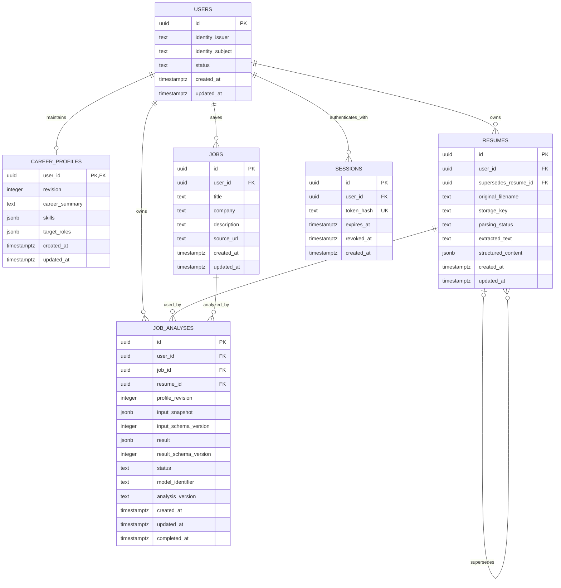

# Agentic Career Copilot Architecture Baseline

## System Shape

The target system shape is:

```text
React + TypeScript
        ↓
FastAPI
        ↓
PostgreSQL
```

The project uses:

- One Git repository
- One React frontend
- One modular FastAPI backend
- One PostgreSQL database
- A modular monolith architecture

The system does not currently use microservices. New deployment units or service boundaries should be introduced only when demonstrated operational or scaling requirements justify them.

## Core Domain Model

### User

User represents the stable platform identity and is responsible for:

- Platform identity
- The ownership boundary for private data
- Account lifecycle

Career data should not accumulate directly on User. It belongs in domain entities with their own lifecycle and validation rules.

### CareerProfile

CareerProfile represents the user's current, confirmed career background, skills, preferences, goals, and target roles.

```text
User → 0..1 CareerProfile
```

A registered user may temporarily have no CareerProfile because registration and profile onboarding are separate steps. Resume parsing or an LLM may suggest profile changes, but it must not silently replace user-confirmed information.

### Resume

One Resume record represents one concrete resume version.

```text
User → many Resume
```

A user may retain an original resume and multiple versions targeted at different roles. An analysis must select a specific Resume; it must not silently substitute whichever version is currently newest. Version lineage can be recorded when a resume supersedes an earlier version.

### Job

Job represents one job description saved in a user's workspace.

```text
User → many Job
```

The saved Job is private user data even when the source job posting is public.

### JobAnalysis

JobAnalysis represents one analysis performed against explicit inputs. It is associated with at least:

- User
- Job
- Resume
- CareerProfile revision or snapshot

```text
Job → many JobAnalysis
```

Multiple analyses are necessary because the selected Resume, CareerProfile, job description, model, and analysis method may change over time.

Each historical analysis must preserve:

- An input snapshot or equivalent immutable input record
- Input and result schema versions
- Model identification
- Analysis implementation version
- Execution status and timestamps

This information makes historical results explainable and prevents later edits from changing the meaning of an earlier analysis.

## Target First-Phase ER Diagram

> This ER diagram represents the target state at the end of the first product phase. It does not mean the next database migration will create every table at once.



The eventual schema should use same-owner constraints where one private resource references another. For example, a JobAnalysis must not associate one user's Job with another user's Resume.

## Ownership and Authorization

Every private resource must belong to a concrete User. This applies to current and future resources, including:

- CareerProfile
- Resume
- Job
- JobAnalysis
- Conversation
- Document
- AgentRun

The backend must not trust a client-provided `user_id` to determine ownership. Authorization follows this path:

```text
verified identity
→ current_user
→ authorized operation scoped by user_id
```

Ownership checks apply to reads, writes, deletes, downloads, relationships, task execution, and task recovery. UUIDs make identifiers difficult to guess, but they do not replace authorization.

## Authentication Decision

The current authentication direction is:

```text
OIDC authentication
→ Backend verifies identity
→ Platform User
→ Server-side Session
→ HttpOnly Cookie
```

- A browser authentication design based on JWT storage in `localStorage` is not the default approach.
- ID Tokens, Access Tokens, or JWTs may still be used as part of the OIDC protocol and backend verification flow.
- Server-side sessions must support expiration, revocation, and logout.
- CSRF protection and `Secure`, `HttpOnly`, and `SameSite` cookie behavior will be designed as part of the Authentication feature.
- The concrete OIDC provider has not been selected.

The platform should maintain its own stable User identifier. External identity should be mapped using trusted issuer and subject identifiers rather than treating an email address as a permanent identity key.

## Database Strategy

The persistence stack will use:

- PostgreSQL
- SQLAlchemy
- Alembic

Alembic migrations are authoritative for the production schema. Application startup must not manage the production schema with `create_all()`.

### Async Database Foundation

The database foundation uses SQLAlchemy 2.x asyncio with Psycopg 3. FastAPI lifespan creates an `AsyncEngine` and `async_sessionmaker`; shutdown awaits `engine.dispose()`. Importing modules does not read database configuration or open connections.

Each request or independent concurrent task owns an `AsyncSession`. Sessions must not be shared between concurrent asyncio tasks. The async database dependency closes the session and rolls back unfinished work without automatically committing. Each work unit explicitly controls its transaction with `async with session.begin()` or explicit commit/rollback. Do not hold database transactions open during LLM calls or streaming.

Alembic uses an asyncio environment and an `AsyncConnection.run_sync` bridge for migration operations. Its SQLAlchemy synchronous facade adapts database operations to the async driver; it is not a separate blocking persistence path. Database integration tests use real PostgreSQL and the same async driver.

`DATABASE_URL` is explicit environment configuration using `postgresql+psycopg://`; there is no fallback database. Credentials are excluded from configuration representations and SQL parameter logging. Local development and CI use PostgreSQL 18.

The initial migration establishes the five core domain tables and the authentication `sessions` table. This is the approved Database Foundation scope; it does not implement their business APIs or authentication behavior. UUIDs are generated by the application. All ownership fields are required. The issuer/subject pair and session token hash are unique. Same-owner composite foreign keys protect analysis inputs and resume lineage.

CareerProfile uses `user_id` as its primary key, so a User can have zero or one Profile. Analysis records retain a Profile revision and input snapshot rather than a foreign key to the mutable current Profile. Jobs require a nonblank JD but may omit title, company, and URL. Resume extraction and analysis output remain nullable until available. JSONB checks enforce basic object/array shape; full business payload schemas will be introduced with parsing and analysis features.

Initial status values are `active`/`disabled` for Users, `pending`/`parsing`/`ready`/`failed` for Resumes, and `pending`/`running`/`succeeded`/`failed` for analyses. Successful analyses require a result, its schema version, model identifier, and completion timestamp; failed analyses require a completion timestamp. These values are enforced with CHECK constraints rather than PostgreSQL ENUMs.

Users, Profiles, Resumes, Jobs, and analyses have creation and update timestamps. SQLAlchemy maintains `updated_at` on updates; raw SQL writers must set it explicitly. Authentication sessions use creation, expiration, and optional revocation timestamps instead. Foreign keys do not automatically cascade deletions; deletion and retention workflows require a later explicit design.

Integration tests require a dedicated database with a name ending in `_test`, distinct from the application database. Tests migrate a generated schema and clean up only that schema. They verify migrations, constraints, async request cleanup, transaction rollback, cancellation, and independent concurrent sessions. These tests prove relationship integrity, not complete API authorization.

Ordinary relational columns should be preferred for ownership, relationships, statuses, timestamps, constraints, and frequently queried fields. Schema-validated JSONB is appropriate for evolving structured AI inputs and results when normalizing the structure would not yet provide a concrete benefit. The complete domain must not be stored as opaque JSONB.

PostgreSQL Row-Level Security will not be introduced in the first CareerProfile migration. Initial data isolation will rely on:

- Verified authentication
- Application-level authorization
- Database foreign keys and same-owner constraints
- Cross-user integration tests

RLS remains a planned security-hardening layer. It should be introduced in a dedicated change after private resource access patterns and operational database roles are mature enough to configure and test it correctly.

## Future Agent Architecture

Later agent capabilities may add:

```text
Conversation
Message
AgentRun
AgentCheckpoint
```

- Conversation and Message store user-visible history.
- AgentRun stores the lifecycle of a task execution.
- AgentCheckpoint stores recoverable LangGraph intermediate state.

Framework execution state must not become authoritative product data. Confirmed CareerProfile facts and other domain records remain the source of truth.

A client-provided `thread_id` must not be treated as an authorization credential. The platform must map framework thread identifiers to owned product records and verify ownership before reading or resuming execution.

These entities and modules should not be created until persistent conversation or multi-step agent behavior is implemented.

## Future RAG Architecture

The future retrieval model may follow:

```text
User
└── Document
    └── Chunk
        └── Embedding / index
```

User isolation must apply throughout:

- Ingestion
- Lexical retrieval
- Vector retrieval
- Reciprocal Rank Fusion
- Reranking
- Citation retrieval
- Caching

Retrieval must apply the authorized user scope while generating candidates. It must not search the entire corpus and filter by user only after retrieval.

Document tables, Chunk tables, embedding storage, vector indexes, and retrieval modules should not be created until personal knowledge retrieval becomes a real product capability.

## Future MCP Direction

MCP integrations should be built on existing, authorized business operations. An MCP tool must not receive:

- Unrestricted ORM access
- Unrestricted SQL access
- Unrestricted credentials

External write operations must account for:

- User authorization
- Confirmation
- Idempotency
- Retry safety
- Auditability
- Revocation

The first MCP integration should be narrow and tied to one concrete user workflow.

## Development Roadmap

Completed foundations:

| Step | Product capability and timing |
| --- | --- |
| Repository, ruleset, and `AGENTS.md` | Establishes a reviewable repository and persistent engineering guidance before feature development. |
| FastAPI backend bootstrap | Establishes the API runtime, testing, linting, and formatting baseline. |
| React frontend bootstrap | Establishes the browser application, type checking, testing, linting, and production build baseline. |
| Backend and frontend CI | Enforces both foundations on every proposed change. |

Planned increments:

| Step | Product capability and timing |
| --- | --- |
| 1. Product & Architecture Baseline | Records the agreed product direction, domain boundaries, security principles, and growth path before persistent business data is introduced. |
| 2. Database Foundation | Adds PostgreSQL, SQLAlchemy, Alembic, and migration testing so identity and career data have reliable persistence. |
| 3. Authentication Backend | Adds verified identity, platform Users, and server-side Sessions before private resource APIs become available. |
| 4. Authentication Frontend | Gives users a secure browser login and session experience against the established backend contract. |
| 5. Career Profile | Lets authenticated users maintain career facts and goals while establishing reusable ownership checks. |
| 6. Resume Upload & Versions | Lets users securely store and select concrete resume versions before parsing or analysis. |
| 7. Resume Parsing & Confirmation | Converts resumes into reviewable structured information; parsing and LLM capabilities are introduced only when there is real user-owned input. |
| 8. Job Workspace | Lets users save and manage target jobs, completing the core set of analysis inputs. |
| 9. Evidence-Based Job Analysis | Produces traceable matches, gaps, uncertainties, and actions from explicit inputs; LLM evaluation, execution resilience, and observability begin with this capability. |
| 10. Persistent Conversation + Streaming | Lets users continue from an analysis and retain visible history; streaming is introduced with an interaction that benefits from it. |
| 11. LangGraph Agent Workflow & Recovery | Adds multi-step execution and recoverable state after concrete agent tasks and tool boundaries exist. |
| 12. Personal Knowledge Retrieval | Grounds results in authorized user documents; document ingestion, chunks, embeddings, and vector retrieval arrive together with this capability. |
| 13. Hybrid Retrieval + RRF + Rerank + Evaluation | Improves retrieval only after a corpus and evaluation baseline can demonstrate quality, latency, and cost tradeoffs. |
| 14. Bounded MCP Integration | Connects one authorized career action to an external system after permission, idempotency, audit, and revocation patterns exist. |
