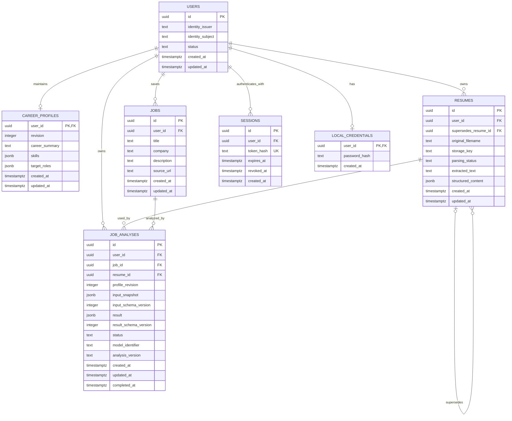

# Agentic Career Copilot Architecture Baseline

## System Shape

The target system shape is:

```text
React + TypeScript
        ↓
FastAPI
        ↓
PostgreSQL
```

The project uses:

- One Git repository
- One React frontend
- One modular FastAPI backend
- One PostgreSQL database
- A modular monolith architecture

The system does not currently use microservices. New deployment units or service boundaries should be introduced only when demonstrated operational or scaling requirements justify them.

## Core Domain Model

### User

User represents the stable platform identity and is responsible for:

- Platform identity
- The ownership boundary for private data
- Account lifecycle

Career data should not accumulate directly on User. It belongs in domain entities with their own lifecycle and validation rules.

### CareerProfile

CareerProfile represents the user's current, confirmed career background, skills, and direction. Its V1 fields are `career_summary: str | null`, `skills: list[str]`, and `target_roles: list[str]`; structured preferences and skill/role taxonomies are not yet modeled.

```text
User → 0..1 CareerProfile
```

A registered user may temporarily have no CareerProfile because registration and profile onboarding are separate steps. Resume parsing or an LLM may suggest profile changes, but it must not silently replace user-confirmed information.

### Resume

One Resume record represents one concrete resume version.

```text
User → many Resume
```

A user may retain an original resume and multiple versions targeted at different roles. An analysis must select a specific Resume; it must not silently substitute whichever version is currently newest. Version lineage can be recorded when a resume supersedes an earlier version.

### Job

Job represents one job description saved in a user's workspace.

```text
User → many Job
```

The saved Job is private user data even when the source job posting is public.

### JobAnalysis

JobAnalysis represents one analysis performed against explicit inputs. It is associated with at least:

- User
- Job
- Resume
- CareerProfile revision or snapshot

```text
Job → many JobAnalysis
```

Multiple analyses are necessary because the selected Resume, CareerProfile, job description, model, and analysis method may change over time.

Each historical analysis must preserve:

- An input snapshot or equivalent immutable input record
- Input and result schema versions
- Model identification
- Analysis implementation version
- Execution status and timestamps

This information makes historical results explainable and prevents later edits from changing the meaning of an earlier analysis.

## Target First-Phase ER Diagram

> This ER diagram represents the target state at the end of the first product phase. It does not mean the next database migration will create every table at once.



The eventual schema should use same-owner constraints where one private resource references another. For example, a JobAnalysis must not associate one user's Job with another user's Resume.

## Ownership and Authorization

Every private resource must belong to a concrete User. This applies to current and future resources, including:

- CareerProfile
- Resume
- Job
- JobAnalysis
- Conversation
- Document
- AgentRun

The backend must not trust a client-provided `user_id` to determine ownership. Authorization follows this path:

```text
verified identity
→ current_user
→ authorized operation scoped by user_id
```

Ownership checks apply to reads, writes, deletes, downloads, relationships, task execution, and task recovery. UUIDs make identifiers difficult to guess, but they do not replace authorization.

### Career Profile API

The first private business API exposes the current User's singleton at `GET /career-profile`, `POST /career-profile` (create), and `PUT /career-profile` (full replacement of an existing Profile). All three reuse `get_current_user`; ownership comes only from `current_user.id`, and every query and write is explicitly scoped to it. Missing Profiles return `404 career_profile_not_found`, including during normal onboarding. Client-supplied owner fields are rejected, and no arbitrary-user route exists.

Creation starts at revision 1. PUT requires a strict positive `expected_revision` in the body and performs one atomic owner-and-revision-scoped UPDATE, increments revision, and explicitly sets `updated_at=clock_timestamp()`. A stale write returns `409 career_profile_conflict`; duplicate creation returns `409 career_profile_already_exists`. Each operation ends its explicit short transaction before returning, after the authentication dependency has already ended its own transaction. The response is validated inside the business transaction, and write responses are returned only after commit. No ETag protocol, automatic merge, history table, or RLS is introduced. See the [Career Profile contract](career-profile.md) for input normalization, responses, errors, and concurrency behavior.

## Authentication Decision

The current authentication implementation is:

```text
Local username/password
→ Argon2id verification
→ Platform User
→ HS256 JWT Bearer
→ PostgreSQL AuthSession validation
→ current_user
```

- Registration creates a User and a separate LocalCredential atomically. Local identity uses `identity_issuer="local"` and a normalized username as `identity_subject`; usernames currently cannot be renamed.
- Passwords use library-managed Argon2id encoding and salts. Expensive hashing and verification run in threads outside database transactions, with a small concurrency bound and a startup-generated dummy hash for unknown usernames.
- Login creates an independent server-side Session and signs a JWT identifying its User (`sub`) and Session (`jti`). Only `SHA-256(raw JWT)` is stored in `sessions.token_hash`.
- JWT ≠ User. JWT ≠ AuthSession. A valid signature alone never authorizes a request: PostgreSQL AuthSession is the single source of truth for session lifecycle and revocation. Authenticated requests also require a current, active User.
- Application-layer User statuses are `active` and `disabled`; unknown statuses fail closed. Disabling a User rejects login and already-issued tokens on subsequent authentication checks. This increment adds no status CHECK constraint or status-management API.
- Each login creates a new Session without revoking other sessions. Sessions expire after 30 minutes by default. Logout revokes only the matching session and accepts repeated logout with the same unexpired, matching JWT.
- Only an explicit `Authorization: Bearer <JWT>` header authenticates requests. Cookies, query parameters, and request bodies do not supply authentication tokens. The current implementation issues no authentication cookie.
- Browser JWT storage in `localStorage` is not the default approach. Frontend token handling and browser security require a separate design; the current API can be used with an in-memory token, with another login after reload or expiration.

See [Authentication API and security](authentication.md) for the exact contract, validation sequence, operational boundaries, and test strategy.

### Frontend Authentication Foundation

The React frontend uses React Router in Declarative mode, a Context/AuthProvider, a small React-independent fetch layer, and plain CSS. `/login` and `/register` are anonymous routes; `/app` is a protected workspace shell. Registration does not establish a Session. Login obtains a temporary credential and calls `/auth/me` before atomically establishing the authenticated User and credential.

JWTs live only in Provider memory. New Provider instances, reloads, and new tabs start anonymous. A local deadline derived from `expires_in` supports UI expiry; it never replaces backend JWT/PostgreSQL validation. Provider-owned authenticated requests coordinate recognized private 401s with route guards, preserve Sessions on infrastructure failures, and use generation checks and cancellation to prevent stale results from affecting a newer Session. Explicit logout clears local state immediately, then attempts server revocation with the captured credential.

The API layer does not import React, own tokens, redirect, or retry POSTs. Auth requests choose their own timeouts; the generic client has no default timeout. Vite rewrites the frontend `/api` path during development, while production requires equivalent reverse-proxy routing. Future private features can add API helpers and server-state management without changing the auth ownership boundary; uploads and streaming should introduce suitable transports when needed. See [frontend authentication](frontend-authentication.md) for behavior and security details.

### Future Authentication Evolution

OIDC and external identity providers remain a future authentication evolution; no concrete provider has been selected. External identities must use verified issuer/subject mappings rather than email as a permanent identity key. An eventual cookie-based browser flow must explicitly design CSRF protection and `Secure`, `HttpOnly`, and `SameSite` attributes.

The current User schema holds only one issuer/subject pair per platform User. It cannot bind both local and Google/GitHub identities to the same User. Supporting multiple identities will require a separate `UserIdentity` migration and explicit account-linking rules. This increment does not create that table or implement OIDC.

The platform User UUID remains the stable ownership identifier across future authentication changes. Local credentials are authentication material, not career data or the platform identity itself.

## Database Strategy

The persistence stack will use:

- PostgreSQL
- SQLAlchemy
- Alembic

Alembic migrations are authoritative for the production schema. Application startup must not manage the production schema with `create_all()`.

### Async Database Foundation

The database foundation uses SQLAlchemy 2.x asyncio with Psycopg 3. FastAPI lifespan creates an `AsyncEngine` and `async_sessionmaker`; shutdown awaits `engine.dispose()`. Importing modules does not read database configuration or open connections.

Each request or independent concurrent task owns an `AsyncSession`. Sessions must not be shared between concurrent asyncio tasks. The async database dependency closes the session and rolls back unfinished work without automatically committing. Each work unit explicitly controls its transaction with `async with session.begin()` or explicit commit/rollback. Do not hold database transactions open during LLM calls or streaming.

Alembic uses an asyncio environment and an `AsyncConnection.run_sync` bridge for migration operations. Its SQLAlchemy synchronous facade adapts database operations to the async driver; it is not a separate blocking persistence path. Database integration tests use real PostgreSQL and the same async driver.

`DATABASE_URL` is explicit environment configuration using `postgresql+psycopg://`; there is no fallback database. Credentials are excluded from configuration representations and SQL parameter logging. Local development and CI use PostgreSQL 18.

The initial migration establishes the five core domain tables and the authentication `sessions` table. This is the approved Database Foundation scope; it does not implement their business APIs or authentication behavior. UUIDs are generated by the application. All ownership fields are required. The issuer/subject pair and session token hash are unique. Same-owner composite foreign keys protect analysis inputs and resume lineage.

CareerProfile uses `user_id` as its primary key, so a User can have zero or one Profile. Its V1 API validates and normalizes string arrays; this needs no new migration or string-element JSONB CHECK. Raw SQL writers can still produce arrays outside the V1 contract, which fail strict response validation without automatic repair. Analysis records retain a Profile revision and input snapshot rather than a foreign key to the mutable current Profile. Jobs require a nonblank JD but may omit title, company, and URL. Resume extraction and analysis output remain nullable until available. Their JSONB checks enforce basic object/array shape; full business payload schemas will be introduced with parsing and analysis features.

User, Resume, and JobAnalysis records include required text status fields. Authentication now defines User statuses at the application layer as described above. Resume and JobAnalysis values, defaults, and lifecycle semantics remain for their corresponding feature work; the Database Foundation does not enforce those workflows.

Users, Profiles, Resumes, Jobs, and analyses have creation and update timestamps. SQLAlchemy maintains `updated_at` on mapped-table updates; CareerProfile replacement explicitly uses PostgreSQL `clock_timestamp()` instead of the shared `now()` expression. Revision, not time, controls concurrency. Raw SQL writers must set update timestamps explicitly. Authentication sessions use creation, expiration, and optional revocation timestamps instead. Migration `0002` adds LocalCredential with only `user_id` (primary key and User foreign key), `password_hash`, and `created_at`. Foreign keys do not automatically cascade deletions; deletion and retention workflows require a later explicit design.

Integration tests require a dedicated database with a name ending in `_test`, distinct from the application database. Tests migrate a generated schema and clean up only that schema. They verify migrations, constraints, async request cleanup, transaction rollback, cancellation, and independent concurrent sessions. CareerProfile tests additionally verify cross-user API authorization, concurrent create/update behavior, and a deterministic PostgreSQL CAS lock wait.

Ordinary relational columns should be preferred for ownership, relationships, statuses, timestamps, constraints, and frequently queried fields. Schema-validated JSONB is appropriate for evolving structured AI inputs and results when normalizing the structure would not yet provide a concrete benefit. The complete domain must not be stored as opaque JSONB.

PostgreSQL Row-Level Security is not introduced by the CareerProfile API, which needs no new migration. Current data isolation relies on:

- Verified authentication
- Application-level authorization
- Database foreign keys and same-owner constraints
- Cross-user integration tests

RLS remains a planned security-hardening layer. It should be introduced in a dedicated change after private resource access patterns and operational database roles are mature enough to configure and test it correctly.

## Future Agent Architecture

Later agent capabilities may add:

```text
Conversation
Message
AgentRun
AgentCheckpoint
```

- Conversation and Message store user-visible history.
- AgentRun stores the lifecycle of a task execution.
- AgentCheckpoint stores recoverable LangGraph intermediate state.

Framework execution state must not become authoritative product data. Confirmed CareerProfile facts and other domain records remain the source of truth.

A client-provided `thread_id` must not be treated as an authorization credential. The platform must map framework thread identifiers to owned product records and verify ownership before reading or resuming execution.

These entities and modules should not be created until persistent conversation or multi-step agent behavior is implemented.

## Future RAG Architecture

The future retrieval model may follow:

```text
User
└── Document
    └── Chunk
        └── Embedding / index
```

User isolation must apply throughout:

- Ingestion
- Lexical retrieval
- Vector retrieval
- Reciprocal Rank Fusion
- Reranking
- Citation retrieval
- Caching

Retrieval must apply the authorized user scope while generating candidates. It must not search the entire corpus and filter by user only after retrieval.

Document tables, Chunk tables, embedding storage, vector indexes, and retrieval modules should not be created until personal knowledge retrieval becomes a real product capability.

## Future MCP Direction

MCP integrations should be built on existing, authorized business operations. An MCP tool must not receive:

- Unrestricted ORM access
- Unrestricted SQL access
- Unrestricted credentials

External write operations must account for:

- User authorization
- Confirmation
- Idempotency
- Retry safety
- Auditability
- Revocation

The first MCP integration should be narrow and tied to one concrete user workflow.

## Development Roadmap

Completed foundations:

| Step | Product capability and timing |
| --- | --- |
| Repository, ruleset, and `AGENTS.md` | Establishes a reviewable repository and persistent engineering guidance before feature development. |
| FastAPI backend bootstrap | Establishes the API runtime, testing, linting, and formatting baseline. |
| React frontend bootstrap | Establishes the browser application, type checking, testing, linting, and production build baseline. |
| Backend and frontend CI | Enforces both foundations on every proposed change. |

Planned increments:

| Step | Product capability and timing |
| --- | --- |
| 1. Product & Architecture Baseline | Records the agreed product direction, domain boundaries, security principles, and growth path before persistent business data is introduced. |
| 2. Database Foundation | Adds PostgreSQL, SQLAlchemy, Alembic, and migration testing so identity and career data have reliable persistence. |
| 3. Authentication Backend | Adds verified identity, platform Users, and server-side Sessions before private resource APIs become available. |
| 4. Authentication Frontend | Gives users a secure browser login and session experience against the established backend contract. |
| 5. Career Profile | Lets authenticated users maintain career facts and goals while establishing reusable ownership checks. |
| 6. Resume Upload & Versions | Lets users securely store and select concrete resume versions before parsing or analysis. |
| 7. Resume Parsing & Confirmation | Converts resumes into reviewable structured information; parsing and LLM capabilities are introduced only when there is real user-owned input. |
| 8. Job Workspace | Lets users save and manage target jobs, completing the core set of analysis inputs. |
| 9. Evidence-Based Job Analysis | Produces traceable matches, gaps, uncertainties, and actions from explicit inputs; LLM evaluation, execution resilience, and observability begin with this capability. |
| 10. Persistent Conversation + Streaming | Lets users continue from an analysis and retain visible history; streaming is introduced with an interaction that benefits from it. |
| 11. LangGraph Agent Workflow & Recovery | Adds multi-step execution and recoverable state after concrete agent tasks and tool boundaries exist. |
| 12. Personal Knowledge Retrieval | Grounds results in authorized user documents; document ingestion, chunks, embeddings, and vector retrieval arrive together with this capability. |
| 13. Hybrid Retrieval + RRF + Rerank + Evaluation | Improves retrieval only after a corpus and evaluation baseline can demonstrate quality, latency, and cost tradeoffs. |
| 14. Bounded MCP Integration | Connects one authorized career action to an external system after permission, idempotency, audit, and revocation patterns exist. |
